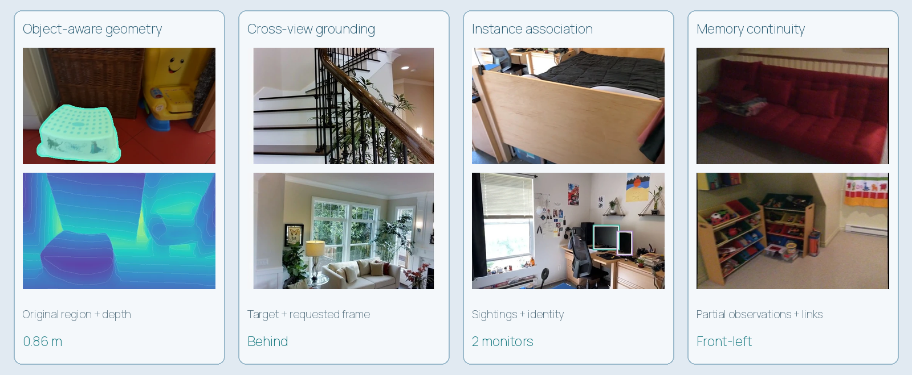

# Evidence in action

[Back to Space-X](README.md)

## Capabilities

Measure object surfaces, reason from another viewpoint, count physical instances, order visual events, and interpret numerical geometry. Each answer is connected to the observations that support it.

## Evidence-chain mechanisms

Bind target, observer and facing roles; associate regions with same-source geometry; carry observations through memory; resolve disputed identities using the original view.

## Before and after

Inspect how requested-image delivery, detail crops, typed metric readouts and category checks repair a specific failure. The visual atlas pairs the earlier error with the changed operation and supported answer.

## What self-evolution retains

Question-relevant source selection, observation relay, camera-frame readouts and reusable tool compositions turn an execution failure into a capability available to later tasks.

## Why the design works

Shared-input comparisons expose the contributions of evidence selection, actual context delivery, semantic binding and completion capacity. Open the interactive atlas to inspect source images, masks, depth, geometric readouts and evidence links.
