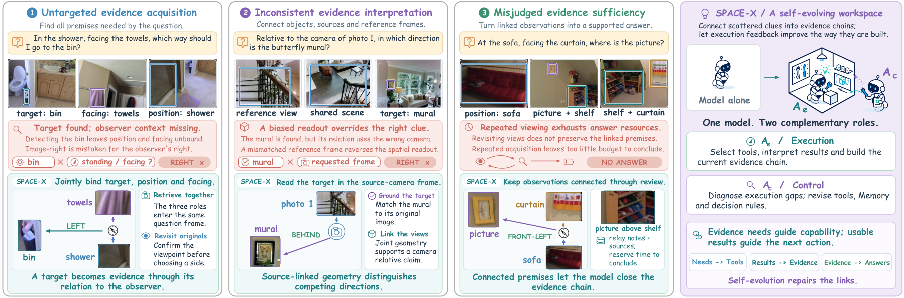
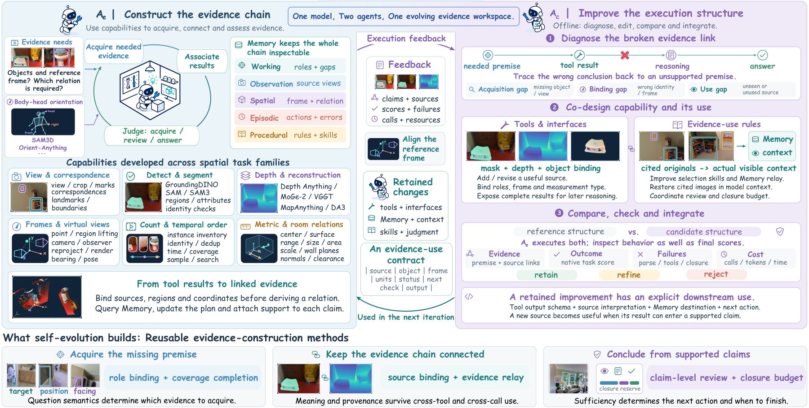
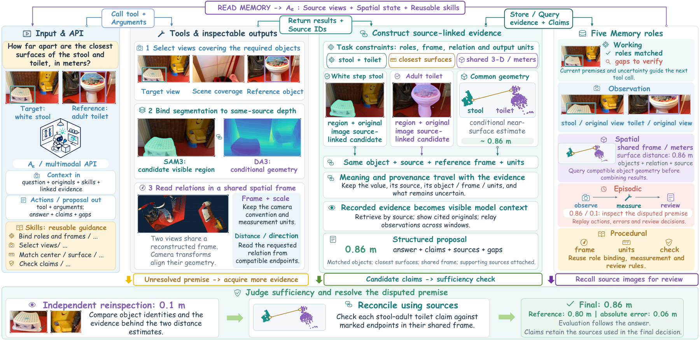
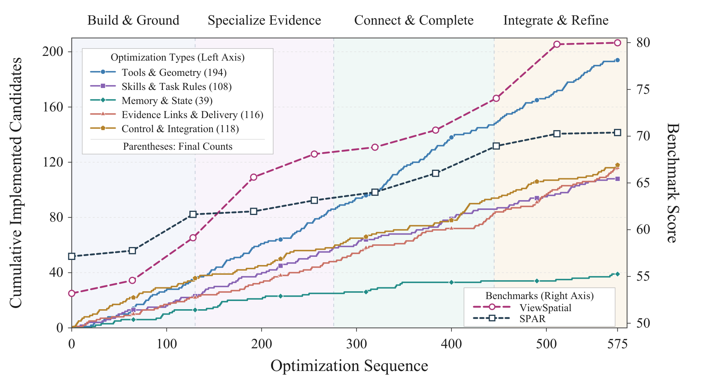
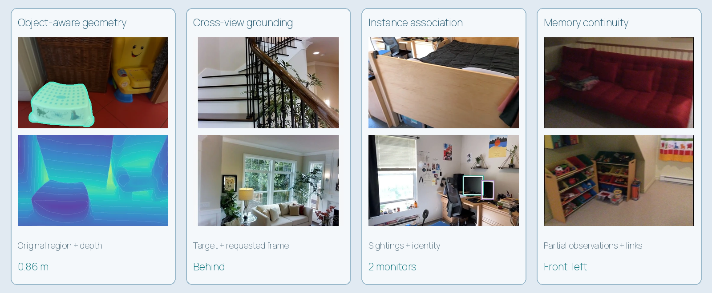

<p align="center"></p>

<h1 align="center">Space-X: Self-Evolving Spatial Agents Weaving Clues into Evidence Chains</h1>

<p align="center"><a href="https://zzj-eric.github.io/Space-X-Project/">Project page</a> · <a href="">Paper</a> · <a href="CASES.md">Case gallery</a></p>


**From seeing to solving.** Space-X evolves the tools **and the connections between their outputs**, turning observations, geometry and memory into evidence that supports spatial answers.

## 🚀 Todo List

- [x] Project page
- [x] Case demonstrations
- [ ] Paper release (Arxiv on hold ...)
- [ ] Code organization and release

## 📄 Abstract

Spatial reasoning connects visual observations, geometric estimates, and linguistic decisions into a coherent derivation. Yet tool-augmented agents often acquire evidence without clear targets, combine outputs under inconsistent object or reference-frame semantics, and misjudge evidence sufficiency. Thus, more tools or calls do not reliably improve reasoning. We introduce Space-X, a spatial-reasoning framework that self-evolves toward complete, continuous evidence-chain construction. An Execution Agent acquires, associates, and judges evidence per problem using role-specific memory. A Control Agent diagnoses evidence-chain breaks from execution traces and jointly revises tools, interfaces, skills, memory organization, and decision rules. This loop co-evolves capability and evidence use: evidence needs guide capability development; usable results guide actions. Across multiple benchmarks, Space-X yields gains with four base models. Relative to baselines, GPT-6-sol improves valid-answer accuracy on ViewSpatial and MMSI by 50.39% and 23.07%, respectively; Gemini-3.8-Flash gains 47.50% and 25.22% on these benchmarks. This provides a unified route from fragmented spatial clues to traceable, derivable answers.

## The Idea: stronger evidence, not just more tools

Spatial questions require more than isolated detections or geometric estimates. Space-X links each observation to the right object, source and reference frame, preserves the connection through memory, and grounds the final decision in the resulting evidence chain.

<p align="center"></p>

## 🔄 Self-evolution shapes the harness

An **Execution Agent** solves spatial tasks. A **Control Agent** diagnoses broken evidence links and jointly improves tools, interfaces, skills, memory and decision rules. Feedback becomes a reusable improvement to the complete reasoning process.

<p align="center"></p>

## Inside Space-X

**Acquire → Associate → Judge.** Source-aware tools supply observations and geometry; five complementary memories retain working state, observations, spatial relations, execution history and procedural experience. The model reasons over connected evidence rather than disconnected outputs.

<p align="center"></p>

## 📈 Measured gains

Same-model comparisons across four spatial benchmarks. Entries show **model alone → Space-X**.

| Base model | ViewSpatial | SPAR | MMSI | VSI (Only 10 frames) |
| :--- | ---: | ---: | ---: | --------: |
| GPT-6-sol | 53.19 → **79.99** | 57.15 → **70.39** | 53.90 → **66.33** | 48.40 → **65.34** |
| GPT-6-astra | 59.89 → **85.26** | 68.96 → **73.82** | 71.60 → **77.70** | 61.08 → **71.99** |
| Gemini-3.8-Flash | 57.78 → **85.22** | 63.00 → **75.79** | 52.65 → **65.93** | 53.09 → **66.42** |
| Gemini-4-Argon | 60.47 → **87.61** | 68.21 → **76.45** | 74.16 → **78.45** | 63.32 → **75.40** |

## Watch capabilities accumulate

Tools, skills, memory, evidence links and execution control evolve together. The recorded sequence contains **575 optimization candidates** and **ten sampled performance checkpoints**. The inherited harness can also continue adapting to another model through **X-SFT**, rather than being rebuilt from scratch.

<p align="center"></p>

## 🔍 See the evidence in action

Surface measurement, cross-view grounding, instance counting and memory continuity expose how a useful tool result becomes part of a supported answer.

<p align="center"></p>

The interactive atlas contains **25 thematic case analyses**: capabilities, evidence-chain mechanisms, before-and-after improvements, self-evolution, and design controls. [Open the case gallery](CASES.md).


## Citation

```bibtex
@misc{zhang2026spacex,
  title  = {Space-X: Self-Evolving Spatial Agents Weaving Clues into Evidence Chains},
  author = {Zhang, Zijian and Tian, Wenqing and Zhang, Lihua and Liu, Qiang and Wang, Liang},
  year   = {2026}
}
```
